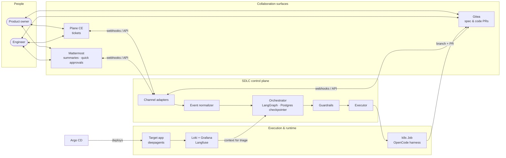
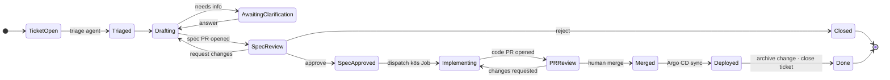

# AI-native SDLC

> From ticket to deployed change: AI agents do the work, humans make the decisions.


&nbsp;·&nbsp; **English** | [Русский](README_ru.md)

**Ship changes at the speed of a ticket.**
An AI-native software development pipeline for companies going all-in on AI: a bug report
or feature request becomes a reviewed spec, a tested PR and a deployed change. Agents
drive it, people gate it. Built to slot into enterprise SDLC workflows on a self-hosted
stack.

> [!NOTE]
> **Status: the platform core runs, the loop is next.** Step 0 of the [roadmap](#roadmap)
> is done: k3s, Argo CD, Postgres, Gitea and Plane run on a local machine and rebuild from
> this repository with one command ([run it](#run-it)). Everything else below is the target
> architecture, and nothing is deployed to the cloud yet. Every decision with its trade-offs
> is in [docs/decisions.md](docs/decisions.md).

---

## In plain words

Today a change to a product goes through many hands: a product manager writes the task,
developers write the code, testers check it, and someone deploys it. Most of that time goes
into routine work, and every change waits its turn in the sprint queue.

This pipeline gives the routine part of that work to AI agents and keeps the decisions with
people:

| | Today | With the pipeline |
|---|---|---|
| Who decides what to build | product owner | product owner |
| Who writes the plan and the code | developers | AI agents |
| Who checks the work | testers and code review | automated tests and an engineer's review |
| Where people spend their time | writing and checking code | deciding what to build and approving the result |
| What a change waits for | a free developer | a person to approve it |

People stay in charge at two points: a product owner approves the plan before any code is
written, and an engineer approves the code before it ships. The same team can take on more
changes, because its time goes into decisions rather than routine. Every decision is
recorded: who asked for what, which plan was approved, and who accepted the code.

It runs on the company's own servers, so code and data never leave them.

> [!IMPORTANT]
> This is the goal, not a proven result. The platform the pipeline runs on is built; the
> loop itself is next on the [roadmap](#roadmap). Whether agents handle real products at
> acceptable quality and cost is exactly what the [metrics](#how-well-know-it-works) will
> show.

## The loop


1. **Signal**: a human files a ticket, or an anomaly in logs or traces opens one automatically.
2. **Triage**: an agent reads the related logs (Loki) and LLM traces (Langfuse) and works out what is actually wrong.
3. **Delta spec**: the agent proposes the fix or feature as an [OpenSpec](https://github.com/Fission-AI/OpenSpec) change, a reviewable *delta* against the current specs, opened as a pull request.
4. **Spec approval** *(human)*: a developer or product owner approves, requests changes, or answers the agent's clarifying questions from Plane, Gitea or Mattermost.
5. **Implementation**: the approved spec is handed to a coding agent that runs as an isolated Kubernetes Job and opens a code PR.
6. **Code review** *(human)*: the regular PR review. The bot cannot merge.
7. **Deploy**: merge to the environment branch, and Argo CD syncs the cluster.
8. **Observe**: logs and traces feed the next signal.

<details>
<summary>Mermaid source</summary>


</details>

## Architecture


The system has three layers:

| Layer | What it is | Who builds it |
|---|---|---|
| **Target app** | A business AI agent (LangGraph / deepagents) that the loop maintains. It emits logs and Langfuse traces. | us |
| **SDLC control plane** | The orchestrator, channel adapters, guardrails and the executor that launches agent jobs. | us |
| **Platform** | Tracker, git and CI, chat, observability, GitOps, identity, all on k3s. | off-the-shelf, configured as code |

Two parts of the control plane are kept deliberately separate:

- **Orchestrator** (long-lived, ours): a LangGraph graph per work item with a Postgres
  checkpointer. It can wait days for a human. Human gates are `interrupt()` and resume.
- **Harness** (short-lived, swappable): the coding agent that does the actual work in a
  Kubernetes Job. It starts as **OpenCode with free models**, behind an `Executor`
  interface, so it can later be replaced by a custom LangGraph harness without touching
  the orchestrator.

<details>
<summary>Mermaid source</summary>



</details>

## Work item lifecycle


The orchestrator owns the state of every work item. Plane, Gitea and Mattermost are
**adapters**: each one turns its webhooks into a common event
(`approve | request_changes | reject | answer`) and mirrors state back. That
makes the following rules easy to enforce:

- **One source of truth.** A Plane status, a Gitea review or a Mattermost button all reach the same transition.
- **No echo loops.** Events written by the bot itself are dropped. Otherwise, mirroring a status to Plane would trigger another transition.
- **No races.** Every event carries the spec revision (the PR head SHA) it refers to. A stale approval is ignored, and its author gets a notification.
- **Correlation.** One record links the Plane issue, the OpenSpec change, the spec PR, the code PR, the Mattermost thread and the LangGraph thread.
- **Resumable clarifications.** When the agent is unsure, it asks in the ticket and the chat thread, then waits. An answer from either place resumes it.

<details>
<summary>Mermaid source</summary>



</details>

## Stack

| Concern | Choice | Why | Considered |
|---|---|---|---|
| Target app and orchestrator | **Python, LangGraph, deepagents** | Python-first agent ecosystem. `interrupt()` and checkpointers map directly onto human gates. | — |
| Coding harness | **OpenCode** + free models | Already wired to OpenSpec commands. Swappable behind an `Executor` interface. | custom LangGraph harness (later) |
| Specs | **OpenSpec** | Delta specs are a reviewable contract between humans and agents. | plain prompts / tickets |
| Git and CI | **Gitea** + Gitea Actions | ~200 MB RAM. Required approvals, approver allowlists and dismissal of stale approvals are free. GitHub Actions compatible. | GitLab CE (4–8 GB RAM, no required approvals in the free tier), Forgejo, OneDev |
| Tracker | **Plane CE** | Jira-like features, REST API and webhooks in the free edition. | GitLab Issues, OpenProject, Redmine, Taiga |
| Chat | **Mattermost TE** | Interactive message buttons for quick approvals. | — |
| Logs | **Loki + Grafana** | Lightweight, and LogQL is easy for an agent to query. | OpenSearch |
| LLM traces | **Langfuse** (self-hosted) | Traces both the target app and the SDLC agents themselves. | — |
| Deploy | **Argo CD** | GitOps: the cluster is reconciled from git, including the platform itself. | Flux |
| Cluster | **k3s** on the host | Real Kubernetes with no VM overhead on a 32 GB laptop. | minikube, kind |
| Database | **One Postgres via CloudNativePG** | One database per service in a single cluster, to save memory. | a Postgres per chart |
| Identity | **Keycloak** | OIDC for Gitea, Grafana, Argo CD and Langfuse. Plane CE and Mattermost TE use local accounts, because OIDC is paid there. | — |

## Security model

The riskiest input in the system is **text the agent didn't write**: logs and traces
contain end-user input, and auto-created tickets carry it straight into an agent that
writes code. The defense has two layers:

| Layer | Controls |
|---|---|
| **Orchestrator** (content) | prompt-injection classifiers, PII detection and redaction, provenance tags on untrusted text |
| **Platform** (blast radius) | per-Job ServiceAccount with minimal RBAC · a token scoped to one repository · NetworkPolicy egress limited to Gitea and the LLM API · no production secrets in agent Jobs · branch protection, so the bot cannot merge |

Above both sit the two human gates: no spec is implemented and no code is merged without
a person approving it.

## Platform on one laptop

The whole platform targets a single 32 GB machine. Components arrive **just in time**:
each one lands with the first change that needs it, not up front.

| Component | RAM |
|---|---|
| k3s itself: API server, containerd, one shim per pod | 1.9 GB *(measured)* |
| Argo CD, Traefik, cert-manager, CloudNativePG operator, CoreDNS | 0.5 GB *(measured)* |
| Postgres (CNPG, shared) | 0.1 GB *(measured, databases still empty)* |
| Gitea | 0.1 GB *(measured)* |
| Plane CE | 1.0 GB *(measured)* |
| Gitea runner | ~0.7–2.2 GB |
| Mattermost, Keycloak | ~1.4 GB |
| Langfuse (with ClickHouse) | ~3 GB |
| Loki, Grafana, Alloy | ~0.8 GB |
| Orchestrator, target app, agent Job | ~1.5 GB |
| **Total** | **~11–12.5 GB**: 3.5 GB measured for what runs today, the rest estimated |

Measured with the platform core idle: the pods' working set (`kubectl top pods`) plus the
memory of the k3s, containerd and shim processes on the host.

LLMs are remote, and running models locally on top of this would not fit.

### Host prerequisites

Example for Ubuntu 26.04 LTS, the author's machine. `platform/bootstrap.sh` checks all of
these before it changes anything and names whatever is missing.

```bash
# usually preinstalled
sudo apt install git openssl jq curl

# certutil: adds the local CA to Chrome's certificate store
sudo apt install libnss3-tools

# yq v4 by Mike Farah (apt's `yq` is a different Python tool with another syntax)
sudo snap install yq

# Helm, the Kubernetes package manager
sudo snap install helm --classic
```

`kubectl` doesn't need a separate install: it comes with k3s, which the bootstrap installs.
You also need `sudo` rights and free ports 80 and 443. Stop Docker Desktop, or anything else
listening there, before bootstrapping.

### Run it

```bash
platform/bootstrap.sh   # build or rebuild the platform: ~11 min from scratch, safe to re-run
platform/smoke.sh       # 15 end-to-end checks
```

Then the services are at <https://gitea.sdlc.internal>, <https://argocd.sdlc.internal> and
<https://plane.sdlc.internal>, with certificates from a local CA that the bootstrap adds to
the system and to Chrome. From here on, every change to the platform is a `git push`: Argo CD
reconciles the cluster from `main` in Gitea, Argo CD itself included. Secret values live in
`~/.config/ai-native-sdlc/secrets.env` and never enter git.

`origin` becomes Gitea. GitHub keeps a public copy of `main` that is pushed by hand, through a
pre-push hook that refuses every other branch and any commit containing a secret value.

Logins, what the bootstrap changes on the host and how to undo it:
[platform/README.md](platform/README.md).

## Roadmap

Each step is one OpenSpec change: spec first, then implementation.

- [x] **0. Platform core**: k3s, Argo CD app-of-apps, CloudNativePG, Gitea, Plane CE ([change](openspec/changes/archive/2026-11-01-platform-core/proposal.md))
- [ ] **1. Spec loop (Plane only)**: ticket → spec PR → clarify / approve via ticket status
- [ ] **2. More channels**: Mattermost buttons and threads, Gitea PR reviews
- [ ] **3. Implementation phase**: approved spec → OpenCode k8s Job → code PR → human merge, CI on a Gitea runner
- [ ] **4. Target app**: a deepagents business agent with Langfuse tracing
- [ ] **5. Triage**: logs (Loki) and traces (Langfuse) in the spec agent's context
- [ ] **6. Auto-tickets**: anomalies open tickets on their own
- [ ] **7. Continuous deploy and SSO**: Argo CD per-environment sync, Keycloak

Once step 1 works, changes to the orchestrator itself go through the orchestrator.

## How we'll know it works

| Metric | Why it matters |
|---|---|
| Lead time, ticket → merged PR | the point of the whole exercise |
| Spec first-pass approval rate | how well the agent understands intent |
| Clarification rounds per item | how much human attention the loop costs |
| Code PR rework rate | harness quality and model quality |
| Cost and tokens per change | whether free models are enough (from Langfuse) |

## Repository

```
openspec/        specs (source of truth), changes in flight and archived ones
docs/            decisions and diagrams
platform/        bootstrap, Argo CD apps, Helm values, smoke checks
orchestrator/    the SDLC control plane                (planned)
apps/            target business agent                 (planned)
```

This repository is built the way it describes: every change starts as an OpenSpec
proposal with delta specs and is implemented only after review.

---

Decisions and trade-offs: **[docs/decisions.md](docs/decisions.md)**
