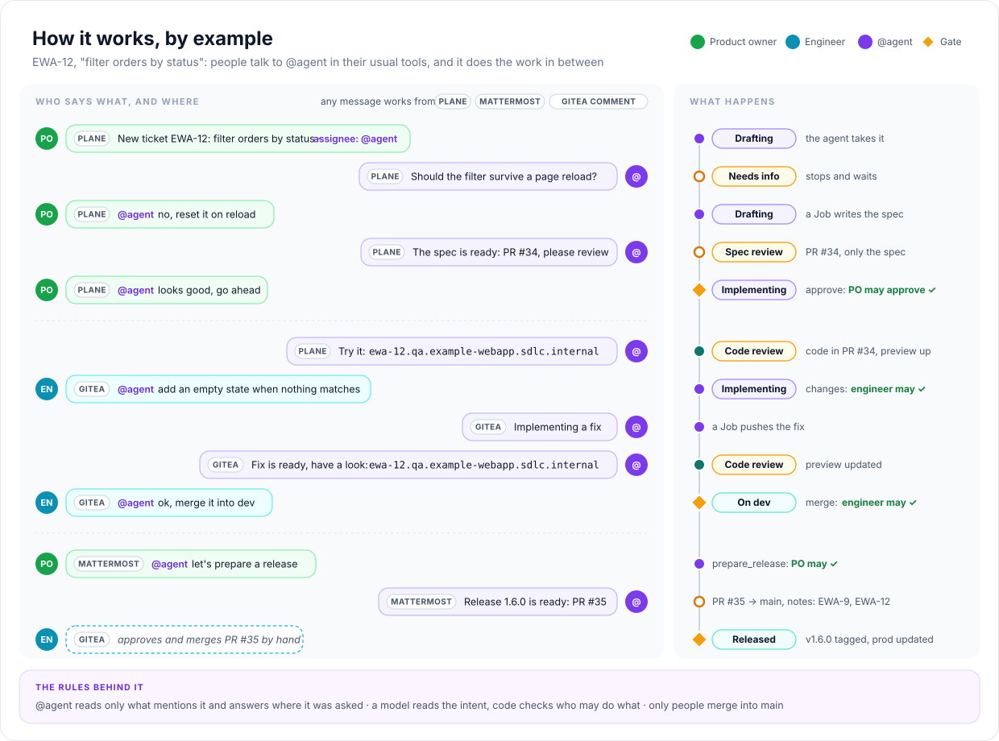
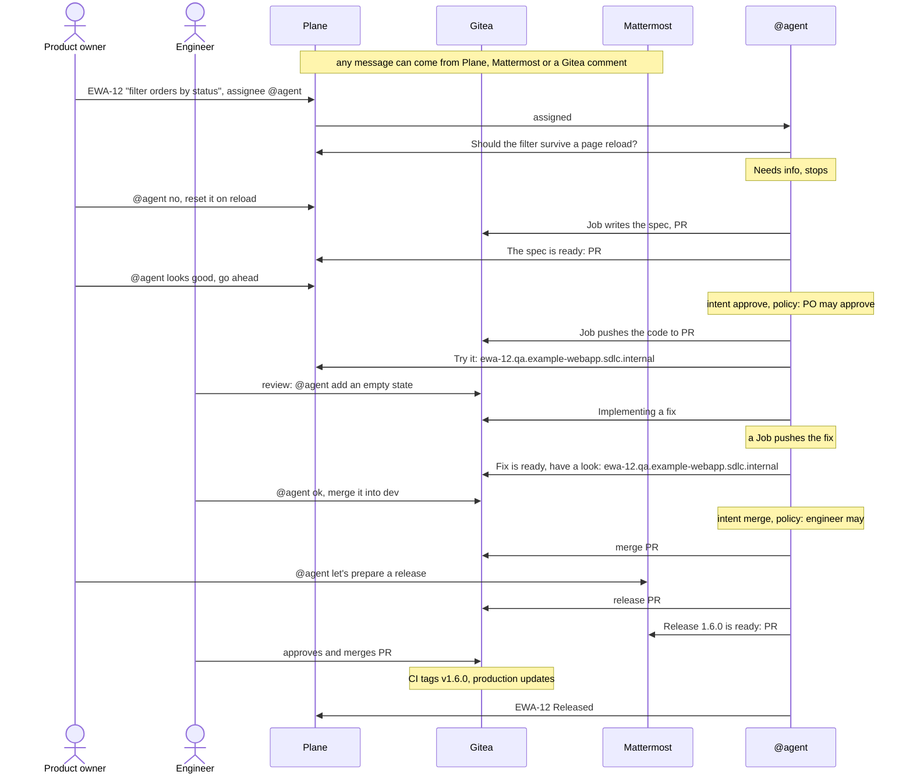
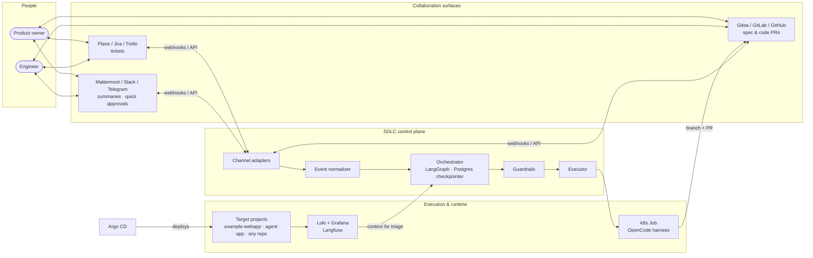
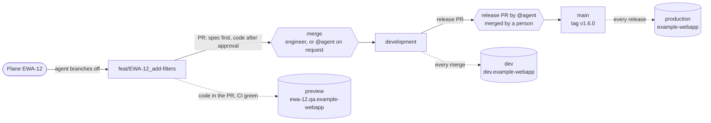
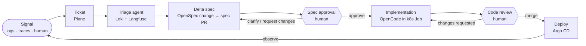
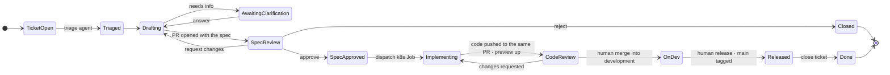

# AI-native SDLC

> From ticket to deployed change: AI agents do the work, humans make the decisions.


&nbsp;·&nbsp; **English** | [Русский](README_ru.md)

**Ship changes at the speed of a ticket.**
An AI-native software development pipeline for companies going all-in on AI: a bug report
or feature request becomes a reviewed spec, a tested PR and a deployed change. Agents
drive it, people gate it. Built to slot into enterprise SDLC workflows on a self-hosted
stack.

> [!NOTE]
> **Status: the platform core runs, the loop is next.** Step 0 of the [roadmap](#roadmap)
> is done: k3s, Argo CD, Postgres, Gitea and Plane run on a local machine and rebuild from
> this repository with one command ([run it](#run-it)). Everything else below is the target
> architecture, and nothing is deployed to the cloud yet. Every decision with its trade-offs
> is in [docs/decisions.md](docs/decisions.md).

---

## In plain words

Today a change to a product goes through many hands: a product manager writes the task,
developers write the code, testers check it, and someone deploys it. Most of that time goes
into routine work, and every change waits its turn in the sprint queue.

This pipeline gives the routine part of that work to AI agents and keeps the decisions with
people:

| | Today | With the pipeline |
|---|---|---|
| Who decides what to build | product owner | product owner |
| Who writes the plan and the code | developers | AI agents |
| Who checks the work | testers and code review | automated tests and an engineer's review |
| Where people spend their time | writing and checking code | deciding what to build and approving the result |
| What a change waits for | a free developer | a person to approve it |

People stay in charge at two points: a product owner approves the plan before any code is
written, and an engineer approves the code before it ships. The same team can take on more
changes, because its time goes into decisions rather than routine. Every decision is
recorded: who asked for what, which plan was approved, and who accepted the code.

It runs on the company's own servers, so code and data never leave them.

> [!IMPORTANT]
> This is the goal, not a proven result. The platform the pipeline runs on is built; the
> loop itself is next on the [roadmap](#roadmap). Whether agents handle real products at
> acceptable quality and cost is exactly what the [metrics](#how-well-know-it-works) will
> show.

## How it works, by example



A product owner wants to filter orders by status on the dashboard of `example-webapp`. This is
the whole path as the people involved see it. *(It is the target flow of roadmap step 1.)*
Any of these messages could just as well come from Plane, Mattermost or a Gitea comment, and
the agent answers where it was asked.

1. **The ticket.** The product owner files EWA-12 in Plane and assigns it to `@agent`. That is
   all the setup there is.
2. **A question.** The agent isn't sure whether the filter should survive a page reload, so it
   asks in the ticket and stops. The product owner answers in a comment that mentions `@agent`.
3. **The spec.** A Job writes the OpenSpec change, and the agent opens PR #34 into
   `development` with only the spec in it. The ticket moves to Spec review.
4. **Approval.** "@agent looks good, go ahead". A model reads this as an approval, and code
   checks that a product owner may approve a spec at this point. Implementation starts.
5. **Code and preview.** The code lands in the same PR, CI passes, and the agent posts a link
   to the preview. The engineer asks for an empty state in a Gitea review. The agent replies
   "Implementing a fix", and a few minutes later "Fix is ready, have a look" with the updated
   preview. The engineer writes "@agent ok, merge it into dev".
6. **Release.** In the chat, the product owner asks the agent to prepare a release. The agent
   opens release PR #35 into `main` with draft notes. Only a person can merge it: the engineer
   does, CI tags v1.6.0, production updates, and EWA-12 becomes Released.

Nobody left their usual tools, and nothing reached production without a person.

<details>
<summary>Mermaid source</summary>



</details>

## Architecture


**ai-native-sdlc is the platform, not the product.** This repository holds the platform and
the orchestrator. The products it works on are the company's own projects: each one lives in
its own Git repository and its own tracker project on the same cluster, and one orchestrator
serves any number of them. Connecting a product is a configuration entry that maps a tracker
project to a repository ([D17](docs/decisions.md#d17-target-apps-live-in-their-own-repositories)).
The first one is `example-webapp`. The same goes for the tools people work in: Plane, Mattermost
and Gitea run here, and Jira, Trello, Slack, Telegram, GitLab or GitHub would each be one more
adapter in front of the same orchestrator.

The system has three layers:

| Layer | What it is | Who builds it |
|---|---|---|
| **Target projects** | The company's products, as many as it has, each in its own repository with its own OpenSpec specs. First `example-webapp`, then a deepagents business agent that emits logs and Langfuse traces. | product teams, together with the agent |
| **SDLC control plane** | The orchestrator, channel adapters, guardrails and the executor that launches agent jobs. | us, in this repository |
| **Platform** | Tracker, git and CI, chat, observability, GitOps, identity, all on k3s. | off-the-shelf, configured as code in this repository |

Two parts of the control plane are kept deliberately separate:

- **Orchestrator** (long-lived, ours): a LangGraph graph per work item with a Postgres
  checkpointer. It can wait days for a human without holding anything open: every event (a
  comment, a status change, a finished Job) runs the graph one step from the saved state. The
  work item's phase is an explicit field, not something inferred from the conversation.
- **Harness** (short-lived, swappable): the coding agent that does the actual work in a
  Kubernetes Job. It starts as **OpenCode** with models reached through an OpenAI-compatible
  router, behind an `Executor` interface, so it can later be replaced by a custom LangGraph
  harness without touching the orchestrator.

<details>
<summary>Mermaid source</summary>



</details>

## Branches and environments


The loop fits into an ordinary branching model instead of replacing it. The first target is
**`example-webapp`**: a small React app with a dummy login form and screens on mocked data.
It lives in its own Gitea repository and is tracked as project `EWA` in Plane.

| Branch | What it holds | Environment | Deployed when |
|---|---|---|---|
| `feat/EWA-12_<slug>` | one ticket's work, branched off `development` | `ewa-12.qa.example-webapp.sdlc.internal` (preview) | the code is in the PR and CI is green |
| `development` | merged features | `dev.example-webapp.sdlc.internal` | on every merge |
| `main` | releases | `example-webapp.sdlc.internal` | a person merges the release PR |

- **One ticket, one id.** The orchestrator names the branch after the Plane ticket, so the
  ticket, the branch, the PR and the preview host share one id. The preview link is posted
  to the ticket.
- **One PR, two gates.** The agent opens a PR into `development` that holds only the
  OpenSpec change. Approving it (a comment to `@agent`, the ticket status, or a review in Gitea)
  starts the implementation, and the code lands in the same PR. The agent archives the change
  there too, so the merged diff also shows how the specs changed. An engineer reviews it and
  merges it, or tells `@agent` to.
- **Previews live as long as the PR.** An Argo CD ApplicationSet watches the repository's PRs
  and deploys the ones the orchestrator has labelled. Closing the PR removes the environment.
- **The agent prepares a release, a person ships it.** When asked, `@agent` opens a release PR
  from `development` into `main` with draft release notes (the tickets since the last tag) and
  posts the link to the ticket or the chat. A person approves and merges it in Gitea. CI then
  tags the next minor version (1.5.0 → 1.6.0; a major bump is set by hand) and publishes the
  release, and the orchestrator moves its tickets to Released.
- **The image tag is the commit SHA, everywhere.** CI builds each pushed commit once, and Argo
  CD deploys the SHA it synced, so no bot commits image tags back to git. The version is a
  label on an image that already exists.
- **Gitea decides who can merge, not the agent.** `main` takes merges only from people, after a
  human approval in the PR (branch protection and a merge allowlist). `development` takes
  merges from the orchestrator's account, which acts only on a request from a person with the
  right role. Agent Jobs push with a separate account that is on no merge allowlist, so a Job
  cannot merge anything, even if a prompt injection tells it to.

> [!NOTE]
> This flow is the design for roadmap step 1 and is not built yet. Previews need wildcard
> names on the host, which `/etc/hosts` can't provide; a spike decides how
> ([open questions](docs/decisions.md#open)).

<details>
<summary>Mermaid source</summary>



</details>

## The loop


1. **Signal**: a human files a ticket, or an anomaly in logs or traces opens one automatically.
2. **Triage**: an agent reads the related logs (Loki) and LLM traces (Langfuse) and works out what is actually wrong.
3. **Delta spec**: the agent proposes the fix or feature as an [OpenSpec](https://github.com/Fission-AI/OpenSpec) change, a reviewable *delta* against the current specs, opened as a pull request.
4. **Spec approval** *(human)*: a developer or product owner approves, requests changes, or answers the agent's clarifying questions by mentioning `@agent` in Plane, Gitea or Mattermost, or with an explicit signal such as a ticket status or a review in Gitea.
5. **Implementation**: the approved spec is handed to a coding agent that runs as an isolated Kubernetes Job and pushes the code to the same pull request. The PR gets a preview environment.
6. **Code review** *(human)*: the regular PR review, plus a click through the preview. Change requests go to `@agent` in Gitea or Plane. The agent merges into `development` only when a person tells it to, and never into `main`.
7. **Deploy**: a merge into `development` reaches the dev environment, and a release merged into `main` reaches production. Argo CD syncs both ([branches and environments](#branches-and-environments)).
8. **Observe**: logs and traces feed the next signal.

<details>
<summary>Mermaid source</summary>



</details>

## Work item lifecycle


The orchestrator owns the state of every work item. People talk to one agent, **`@agent`**,
which has a service account in Plane, Gitea and later Mattermost; behind every account is the
same orchestrator. Each system is an **adapter** that turns its webhooks into a common event
and mirrors state back. That makes the following rules easy to enforce:

- **It works on what it is given.** The agent takes a ticket only when the ticket is assigned
  to `@agent`, and reads only the comments that mention it. Conversations between people stay
  between people.
- **Words in, rules decide.** A model reads a comment such as "@agent looks good, merge it into
  dev" and turns it into an intent: `approve`, `request_changes`, `answer`, `merge` or
  `prepare_release`. Whether the intent is carried out is decided by code: who asked, what role
  they have, and what phase the work item is in. A misread comment costs a clarifying question,
  not an unauthorized action. Explicit signals, such as a ticket status or an Approve review in
  Gitea, go through the same rules without the model.
- **One source of truth.** A Plane comment, a Gitea review or a Mattermost reply reaches the same transition.
- **No echo loops.** The agent never mentions itself, and events it wrote are dropped.
- **Correlation.** One record links the Plane issue, the OpenSpec change, the branch and its PR, the preview, the Mattermost thread and the LangGraph thread.
- **Clarifications.** When the agent is unsure, it asks in the ticket (later also in the chat thread) and stops. The next comment that mentions it continues the work.
- **No stale approvals** *(after step 1)*. An approval applies to the spec revision the agent reported (the PR head SHA). If the spec changed since, the approval is ignored and its author is told.

<details>
<summary>Mermaid source</summary>



</details>

## Stack

| Concern | Choice | Why | Considered |
|---|---|---|---|
| Orchestrator and the agent app | **Python, LangGraph, deepagents** | Python-first agent ecosystem. Checkpointers keep each work item's state between events that can be days apart. | — |
| Coding harness | **OpenCode** + models via RouterAI | Already wired to OpenSpec commands. Swappable behind an `Executor` interface. The model and the provider are configuration: DeepSeek V4 Flash for tests and first demos; GLM-5.3 or Kimi K3-class models for coding and review, aiming at frontier-level code at a fraction of the price, which the [metrics](#how-well-know-it-works) have to confirm. | custom LangGraph harness (later) |
| Specs | **OpenSpec** | Delta specs are a reviewable contract between humans and agents. | plain prompts / tickets |
| Git and CI | **Gitea** + Gitea Actions | ~200 MB RAM. Required approvals, approver allowlists and dismissal of stale approvals are free. GitHub Actions compatible. | GitLab CE (4–8 GB RAM, no required approvals in the free tier), Forgejo, OneDev |
| Tracker | **Plane CE** | Jira-like features, REST API and webhooks in the free edition. | GitLab Issues, OpenProject, Redmine, Taiga |
| Chat | **Mattermost TE** | Interactive message buttons for quick approvals. | — |
| Logs | **Loki + Grafana** | Lightweight, and LogQL is easy for an agent to query. | OpenSearch |
| LLM traces | **Langfuse** (self-hosted) | Traces the SDLC agents themselves and the target projects that call LLMs. | — |
| Deploy | **Argo CD** | GitOps: the cluster is reconciled from git, including the platform itself. | Flux |
| Cluster | **k3s** on the host | Real Kubernetes with no VM overhead on a 32 GB laptop. | minikube, kind |
| Database | **One Postgres via CloudNativePG** | One database per service in a single cluster, to save memory. | a Postgres per chart |
| Identity | **Keycloak** | OIDC for Gitea, Grafana, Argo CD and Langfuse. Plane CE and Mattermost TE use local accounts, because OIDC is paid there. | — |

## Security model

The riskiest input in the system is **text the agent didn't write**: logs and traces
contain end-user input, and auto-created tickets carry it straight into an agent that
writes code. The defense has two layers:

| Layer | Controls |
|---|---|
| **Orchestrator** (content) | prompt-injection classifiers, PII detection and redaction, provenance tags on untrusted text |
| **Platform** (blast radius) | per-Job ServiceAccount with minimal RBAC · a token scoped to one repository · NetworkPolicy egress limited to Gitea and the LLM API · no production secrets in agent Jobs · Jobs push with an account that cannot merge · only people merge into `main`, enforced by Gitea |

Above both sit the two human gates: no spec is implemented and no code is merged without
a person approving it.

## Platform on one laptop

The whole platform targets a single 32 GB machine. Components arrive **just in time**:
each one lands with the first change that needs it, not up front.

| Component | RAM |
|---|---|
| k3s itself: API server, containerd, one shim per pod | 1.9 GB *(measured)* |
| Argo CD, Traefik, cert-manager, CloudNativePG operator, CoreDNS | 0.5 GB *(measured)* |
| Postgres (CNPG, shared) | 0.1 GB *(measured, databases still empty)* |
| Gitea | 0.1 GB *(measured)* |
| Plane CE | 1.0 GB *(measured)* |
| Gitea runner | ~0.7–2.2 GB |
| Mattermost, Keycloak | ~1.4 GB |
| Langfuse (with ClickHouse) | ~3 GB |
| Loki, Grafana, Alloy | ~0.8 GB |
| Orchestrator, target projects, agent Job | ~1.5 GB |
| **Total** | **~11–12.5 GB**: 3.5 GB measured for what runs today, the rest estimated |

Measured with the platform core idle: the pods' working set (`kubectl top pods`) plus the
memory of the k3s, containerd and shim processes on the host.

LLMs are remote, and running models locally on top of this would not fit.

### Host prerequisites

Example for Ubuntu 26.04 LTS, the author's machine. `platform/bootstrap.sh` checks all of
these before it changes anything and names whatever is missing.

```bash
# usually preinstalled
sudo apt install git openssl jq curl

# certutil: adds the local CA to Chrome's certificate store
sudo apt install libnss3-tools

# yq v4 by Mike Farah (apt's `yq` is a different Python tool with another syntax)
sudo snap install yq

# Helm, the Kubernetes package manager
sudo snap install helm --classic
```

`kubectl` doesn't need a separate install: it comes with k3s, which the bootstrap installs.
You also need `sudo` rights and free ports 80 and 443. Stop Docker Desktop, or anything else
listening there, before bootstrapping.

### Run it

```bash
platform/bootstrap.sh   # build or rebuild the platform: ~11 min from scratch, safe to re-run
platform/smoke.sh       # 15 end-to-end checks
```

Then the services are at <https://gitea.sdlc.internal>, <https://argocd.sdlc.internal> and
<https://plane.sdlc.internal>, with certificates from a local CA that the bootstrap adds to
the system and to Chrome. From here on, every change to the platform is a `git push`: Argo CD
reconciles the cluster from `main` in Gitea, Argo CD itself included. Secret values live in
`~/.config/ai-native-sdlc/secrets.env` and never enter git.

`origin` becomes Gitea. GitHub keeps a public copy of `main` that is pushed by hand, through a
pre-push hook that refuses every other branch and any commit containing a secret value.

Logins, what the bootstrap changes on the host and how to undo it:
[platform/README.md](platform/README.md).

## Roadmap

Each step is one OpenSpec change: spec first, then implementation.

- [x] **0. Platform core**: k3s, Argo CD app-of-apps, CloudNativePG, Gitea, Plane CE ([change](openspec/changes/archive/2026-11-01-platform-core/proposal.md))
- [ ] **1. Delivery loop on `example-webapp`**: a Plane ticket assigned to `@agent` → spec in a PR → approval to `@agent` in Plane or Gitea → code from an OpenCode k8s Job in the same PR → merge into `development` by a person or at their request, with [previews, dev and production](#branches-and-environments), releases prepared by the agent, and CI on a Gitea runner
- [ ] **2. Target agent app**: a deepagents business agent with Langfuse tracing, in its own repository
- [ ] **3. Triage**: logs (Loki) and traces (Langfuse) in the spec agent's context
- [ ] **4. More channels**: Mattermost threads and buttons
- [ ] **5. Auto-tickets**: anomalies open tickets on their own
- [ ] **6. SSO**: Keycloak

The order changes as we learn. It was reshuffled once already: the full loop on a simple app
came first, because that is what the main metric measures. Once step 1 works, changes to the
orchestrator itself go through the orchestrator.

## How we'll know it works

| Metric | Why it matters |
|---|---|
| Lead time, ticket → merged PR | the point of the whole exercise |
| Spec first-pass approval rate | how well the agent understands intent |
| Clarification rounds per item | how much human attention the loop costs |
| Code PR rework rate | harness quality and model quality |
| Cost and tokens per change | whether cheap open models are enough (from Langfuse) |

## Repository

```
openspec/        specs (source of truth), changes in flight and archived ones
docs/            decisions and diagrams
platform/        bootstrap, Argo CD apps, Helm values, smoke checks
orchestrator/    the SDLC control plane                (planned)
```

Target apps live in their own repositories, starting with `example-webapp`, so the
orchestrator works across repositories from the start ([D17](docs/decisions.md#d17-target-apps-live-in-their-own-repositories)).

This repository is built the way it describes: every change starts as an OpenSpec
proposal with delta specs and is implemented only after review.

---

Decisions and trade-offs: **[docs/decisions.md](docs/decisions.md)**
