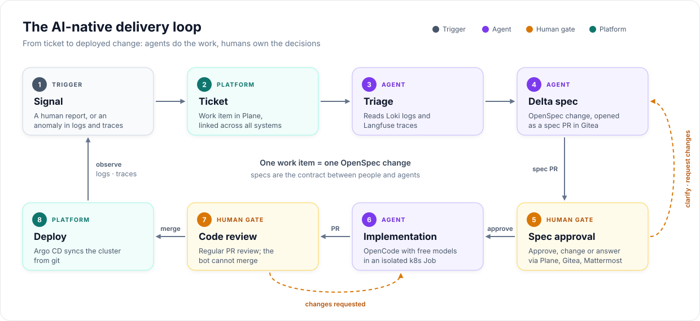
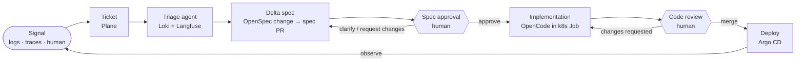
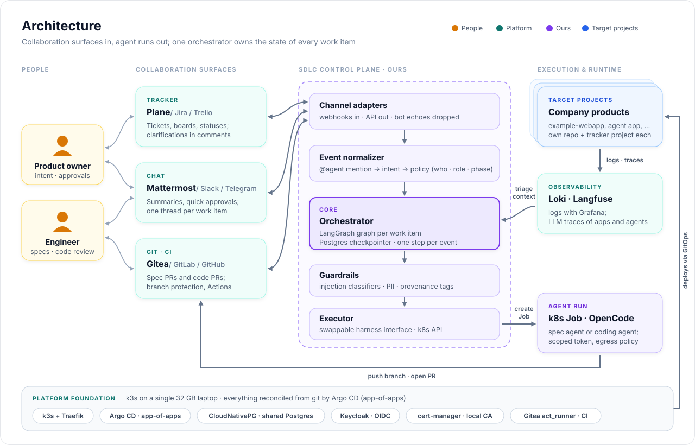
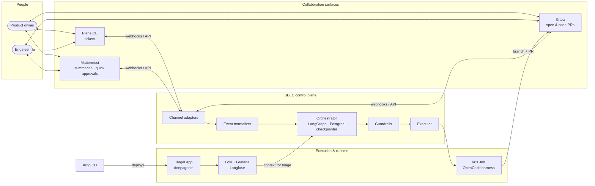
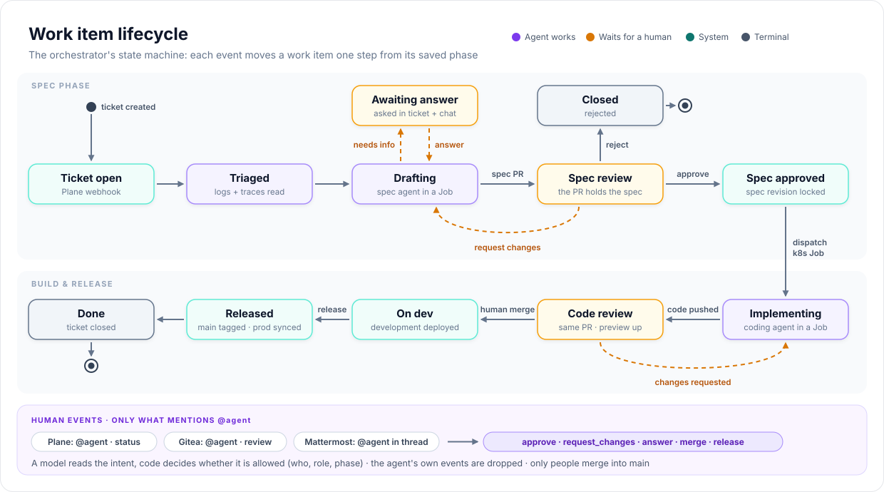
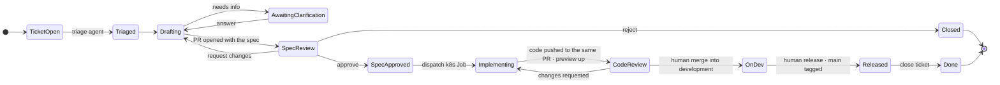
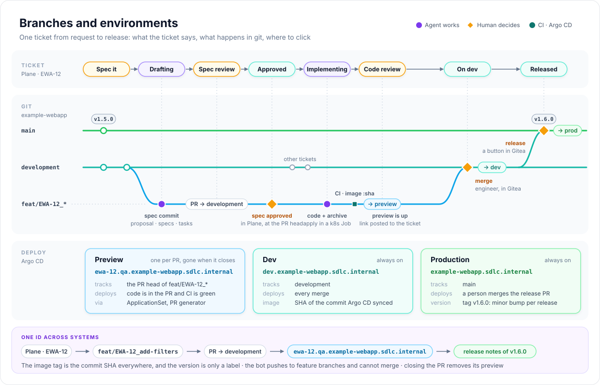
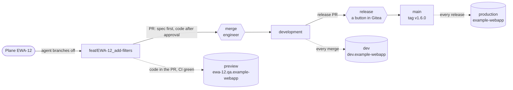

# AI-native SDLC

> От тикета до задеплоенного изменения: работу делают AI-агенты, решения принимают люди.


&nbsp;·&nbsp; [English](README.md) | **Русский**

**Изменения со скоростью тикета.**
AI-native пайплайн разработки ПО для компаний, которые делают ставку на AI целиком:
баг-репорт или фича-реквест превращается в отревьюенную спеку, протестированный PR и
задеплоенное изменение. Делают агенты, утверждают люди. Встраивается в корпоративный
SDLC на self-hosted стеке.

> [!NOTE]
> **Статус: ядро платформы работает, дальше цикл.** Шаг 0 [роадмапа](#роадмап) готов:
> k3s, Argo CD, Postgres, Gitea и Plane крутятся на локальной машине и пересобираются из
> этого репозитория одной командой ([как запустить](#как-запустить)). Всё остальное ниже —
> целевая архитектура, в облако ничего не задеплоено. Все решения с компромиссами — в
> [docs/decisions.md](docs/decisions.md) (на английском).

---

## Простыми словами

Сегодня любое изменение продукта проходит через много рук: продакт пишет задачу,
разработчики пишут код, тестировщики проверяют, кто-то выкатывает. Большая часть этого
времени уходит на рутину, а каждое изменение ждёт своей очереди в спринте.

Этот пайплайн отдаёт рутинную часть работы AI-агентам, а решения оставляет людям:

| | Сейчас | С пайплайном |
|---|---|---|
| Кто решает, что делать | продакт | продакт |
| Кто пишет план и код | разработчики | AI-агенты |
| Кто проверяет работу | тестировщики и код-ревью | автотесты и ревью инженера |
| На что уходит время людей | написание и проверку кода | решения, что делать, и приёмку результата |
| Чего ждёт изменение | свободного разработчика | одобрения человеком |

Люди остаются главными в двух точках: продакт одобряет план до того, как написана хоть
строчка кода, а инженер принимает код до выкатки. Та же команда может взять больше
изменений, потому что её время уходит на решения, а не на рутину. Каждое решение записано:
кто что попросил, какой план одобрили и кто принял код.

Всё работает на собственных серверах компании, код и данные их не покидают.

> [!IMPORTANT]
> Это цель, а не доказанный результат. Платформа, на которой работает пайплайн, готова; сам
> цикл — следующий шаг [роадмапа](#роадмап). Справляются ли агенты с реальными продуктами
> с приемлемым качеством и ценой — как раз это и покажут [метрики](#как-поймём-что-работает).

## Цикл



1. **Сигнал**: человек заводит тикет, или аномалия в логах/трейсах создаёт его автоматически.
2. **Триаж**: агент читает связанные логи (Loki) и LLM-трейсы (Langfuse) и разбирается, что на самом деле сломалось.
3. **Delta spec**: агент предлагает фикс или фичу как change в [OpenSpec](https://github.com/Fission-AI/OpenSpec) — ревьюируемую *дельту* к текущим спекам, оформленную пулл-реквестом.
4. **Апрув спеки** *(человек)*: разработчик или product owner апрувит, просит доработать или отвечает на уточняющие вопросы агента — из Plane, Gitea или Mattermost.
5. **Реализация**: одобренная спека уходит кодинг-агенту, который работает в изолированном Kubernetes Job и пушит код в тот же пулл-реквест. У PR появляется превью-окружение.
6. **Код-ревью** *(человек)*: обычное ревью PR плюс прогулка по превью. Бот смёржить не может.
7. **Деплой**: мёрж в `development` доезжает до dev-окружения, а релиз, смёрженный в `main`, — до продакшена. Оба синхронизирует Argo CD ([ветки и окружения](#ветки-и-окружения)).
8. **Наблюдение**: логи и трейсы порождают следующий сигнал.

<details>
<summary>Исходник Mermaid</summary>



</details>

## Архитектура



Три слоя:

| Слой | Что это | Кто делает |
|---|---|---|
| **Целевое приложение** | Бизнес-агент (LangGraph / deepagents), которого обслуживает цикл. Пишет логи и трейсы в Langfuse. | мы |
| **SDLC control plane** | Оркестратор, адаптеры каналов, guardrails и executor, запускающий агентские джобы. | мы |
| **Платформа** | Трекер, git и CI, чат, observability, GitOps, identity — всё на k3s. | готовое, конфигурируется как код |

Две части control plane намеренно разделены:

- **Оркестратор** (долгоживущий, наш): LangGraph-граф на каждый work item с Postgres-
  чекпоинтером. Может днями ждать человека: человеческие гейты — это `interrupt()` и resume.
- **Харнесс** (короткоживущий, заменяемый): кодинг-агент, который делает работу в
  Kubernetes Job. Стартуем с **OpenCode на бесплатных моделях** за интерфейсом `Executor`,
  поэтому позже его можно заменить на свой LangGraph-харнесс, не трогая оркестратор.

<details>
<summary>Исходник Mermaid</summary>



</details>

## Жизненный цикл work item



Состоянием каждого work item владеет оркестратор. Plane, Gitea и Mattermost — это
**адаптеры**: каждый превращает свои вебхуки в общее событие
(`approve | request_changes | reject | answer`) и отражает состояние обратно. Поэтому
легко соблюдать такие правила:

- **Один источник правды.** Статус в Plane, ревью в Gitea и кнопка в Mattermost ведут к одному и тому же переходу.
- **Без эхо-петель.** События, которые породил сам бот, отбрасываются. Иначе зеркалирование статуса в Plane вызвало бы ещё один переход.
- **Без гонок.** Каждое событие несёт ревизию спеки (head SHA пулл-реквеста), к которой относится. Устаревший апрув игнорируется, и его автору приходит уведомление.
- **Корреляция.** Одна запись связывает тикет в Plane, change в OpenSpec, ветку и её PR, превью, тред в Mattermost и тред в LangGraph.
- **Возобновляемые уточнения.** Когда агент не уверен, он спрашивает в тикете и в треде чата и ждёт. Ответ из любого места его возобновляет.

<details>
<summary>Исходник Mermaid</summary>



</details>

## Ветки и окружения



Цикл встраивается в обычную модель веток, а не заменяет её. Первая цель — **`example-webapp`**:
небольшое React-приложение с формой логина-заглушкой и экранами на моковых данных. У него свой
репозиторий в Gitea, а задачи ведутся в проекте `EWA` в Plane.

| Ветка | Что в ней | Окружение | Когда деплоится |
|---|---|---|---|
| `feat/EWA-12_<slug>` | работа по одному тикету, ответвлена от `development` | `ewa-12.qa.example-webapp.sdlc.internal` (превью) | код уже в PR, и CI зелёный |
| `development` | смёрженные фичи | `dev.example-webapp.sdlc.internal` | на каждый мёрж |
| `main` | релизы | `example-webapp.sdlc.internal` | человек мёржит релизный PR |

- **Один тикет — один id.** Оркестратор называет ветку по тикету в Plane, поэтому у тикета,
  ветки, PR и хоста превью один и тот же id. Ссылка на превью приходит в тикет.
- **Один PR, два гейта.** Агент открывает PR в `development`, в котором поначалу только
  change в OpenSpec. Апрув в Plane запускает реализацию, и код попадает в тот же PR. Там же агент
  архивирует change, так что в смёрженном диффе видно и то, как изменились спеки. Ревьюит и мёржит
  инженер.
- **Превью живёт, пока жив PR.** ApplicationSet в Argo CD следит за PR репозитория и деплоит
  те, на которые оркестратор повесил метку. Закрыли PR — окружение удалилось.
- **Релиз — это кнопка.** Человек мёржит `development` в `main` в Gitea. CI ставит тег
  следующей минорной версии (1.5.0 → 1.6.0; мажорную поднимают руками) и публикует релиз со
  списком тикетов, а оркестратор переводит эти тикеты в Released.
- **Тег образа — SHA коммита, везде.** CI собирает каждый запушенный коммит один раз, а Argo CD
  деплоит тот SHA, который синхронизировал, так что ни один бот не коммитит теги образов обратно
  в git. Версия — это ярлык на уже собранном образе.
- **Бот не может мёржить.** `development` и `main` защищены. Токен агента пушит только в
  feature-ветки.

> [!NOTE]
> Этот флоу — дизайн шага 1 роадмапа, он ещё не построен. Превью нужны wildcard-имена на
> хосте, а `/etc/hosts` так не умеет; как это решить, покажет спайк
> ([открытые вопросы](docs/decisions.md#open)).

<details>
<summary>Исходник Mermaid</summary>



</details>

## Стек

| Задача | Выбор | Почему | Рассматривали |
|---|---|---|---|
| Целевое приложение и оркестратор | **Python, LangGraph, deepagents** | Экосистема агентов в первую очередь на Python. `interrupt()` и чекпоинтеры напрямую ложатся на человеческие гейты. | — |
| Кодинг-харнесс | **OpenCode** + бесплатные модели | Уже связан с командами OpenSpec. Заменяем через интерфейс `Executor`. | свой LangGraph-харнесс (позже) |
| Спеки | **OpenSpec** | Delta specs — ревьюируемый контракт между людьми и агентами. | просто промпты / тикеты |
| Git и CI | **Gitea** + Gitea Actions | ~200 МБ RAM. Обязательные апрувы, allowlist апруверов и сброс устаревших апрувов — бесплатно. Совместим с GitHub Actions. | GitLab CE (4–8 ГБ RAM, в бесплатной версии нет обязательных апрувов), Forgejo, OneDev |
| Трекер | **Plane CE** | Фичи уровня Jira, REST API и вебхуки в бесплатной редакции. | GitLab Issues, OpenProject, Redmine, Taiga |
| Чат | **Mattermost TE** | Интерактивные кнопки в сообщениях для быстрых апрувов. | — |
| Логи | **Loki + Grafana** | Лёгкие, а по LogQL агенту удобно делать запросы. | OpenSearch |
| LLM-трейсы | **Langfuse** (self-hosted) | Трейсит и целевое приложение, и самих SDLC-агентов. | — |
| Деплой | **Argo CD** | GitOps: кластер, включая саму платформу, приводится в состояние из git. | Flux |
| Кластер | **k3s** прямо на хосте | Настоящий Kubernetes без оверхеда на VM на ноутбуке с 32 ГБ. | minikube, kind |
| База | **Один Postgres через CloudNativePG** | По базе на сервис в одном кластере, чтобы экономить память. | отдельный Postgres на каждый чарт |
| Identity | **Keycloak** | OIDC для Gitea, Grafana, Argo CD и Langfuse. В Plane CE и Mattermost TE — локальные аккаунты, потому что OIDC там платный. | — |

## Модель безопасности

Самый рискованный вход в системе — **текст, который написал не агент**: в логах и трейсах
есть пользовательский ввод, а автотикеты несут его прямо в агента, который пишет код.
Защита в два слоя:

| Слой | Меры |
|---|---|
| **Оркестратор** (содержимое) | классификаторы prompt injection, детект и маскирование PII, метки происхождения на недоверенном тексте |
| **Платформа** (радиус поражения) | отдельный ServiceAccount на Job с минимальным RBAC · токен на один репозиторий · NetworkPolicy, выпускающая только в Gitea и LLM API · никаких продовых секретов в агентских джобах · branch protection, бот не может мёржить |

Поверх обоих слоёв — два человеческих гейта: без одобрения человека ни одна спека не
реализуется и ни один код не мёржится.

## Платформа на одном ноутбуке

Вся платформа рассчитана на одну машину с 32 ГБ. Компоненты приезжают **just in time**:
каждый — вместе с первым change, которому он нужен, а не заранее.

| Компонент | RAM |
|---|---|
| Сам k3s: API-сервер, containerd, по shim на каждый под | 1.9 ГБ *(замер)* |
| Argo CD, Traefik, cert-manager, оператор CloudNativePG, CoreDNS | 0.5 ГБ *(замер)* |
| Postgres (CNPG, общий) | 0.1 ГБ *(замер, базы пока пустые)* |
| Gitea | 0.1 ГБ *(замер)* |
| Plane CE | 1.0 ГБ *(замер)* |
| Раннер Gitea | ~0.7–2.2 ГБ |
| Mattermost, Keycloak | ~1.4 ГБ |
| Langfuse (с ClickHouse) | ~3 ГБ |
| Loki, Grafana, Alloy | ~0.8 ГБ |
| Оркестратор, целевое приложение, агентский Job | ~1.5 ГБ |
| **Итого** | **~11–12.5 ГБ**: 3.5 ГБ замерено для того, что уже работает, остальное оценка |

Замер на простаивающем ядре платформы: рабочий набор подов (`kubectl top pods`) плюс память
процессов k3s, containerd и shim'ов на хосте.

LLM удалённые, локальные модели поверх всего этого не влезут.

### Что нужно на хосте

Пример для Ubuntu 26.04 LTS — машины автора. `platform/bootstrap.sh` проверяет всё это до
того, как что-либо менять, и называет то, чего не хватает.

```bash
# обычно уже стоят
sudo apt install git openssl jq curl

# certutil: добавляет локальный CA в хранилище сертификатов Chrome
sudo apt install libnss3-tools

# yq v4 от Mike Farah (`yq` из apt — другая Python-утилита с другим синтаксисом)
sudo snap install yq

# Helm, пакетный менеджер Kubernetes
sudo snap install helm --classic
```

`kubectl` отдельно ставить не нужно: он идёт вместе с k3s, которую ставит бутстрап. Ещё
нужны права `sudo` и свободные порты 80 и 443. Перед бутстрапом останови Docker Desktop
или что-то ещё, что их слушает.

### Как запустить

```bash
platform/bootstrap.sh   # собрать или пересобрать платформу: ~11 мин с нуля, можно перезапускать
platform/smoke.sh       # 15 сквозных проверок
```

После этого сервисы доступны на <https://gitea.sdlc.internal>, <https://argocd.sdlc.internal>
и <https://plane.sdlc.internal>, с сертификатами от локального CA, который бутстрап добавляет
в систему и в Chrome. Дальше любое изменение платформы — это `git push`: Argo CD приводит
кластер к `main` в Gitea, включая сам Argo CD. Значения секретов лежат в
`~/.config/ai-native-sdlc/secrets.env` и в git не попадают.

`origin` становится Gitea. На GitHub остаётся публичная копия `main`, её пушат руками через
pre-push хук, который не пропускает другие ветки и коммиты со значениями секретов.

Логины, что бутстрап меняет на хосте и как это откатить — в
[platform/README.md](platform/README.md) (на английском).

## Роадмап

Каждый шаг — один change в OpenSpec: сначала спека, потом реализация.

- [x] **0. Ядро платформы**: k3s, Argo CD app-of-apps, CloudNativePG, Gitea, Plane CE ([change](openspec/changes/archive/2026-11-01-platform-core/proposal.md))
- [ ] **1. Цикл поставки на `example-webapp`**: тикет в Plane → спека в PR → апрув в тикете → код от OpenCode в k8s Job в том же PR → мёрж человеком, плюс [превью, dev и продакшен](#ветки-и-окружения), релизы и CI на раннере Gitea
- [ ] **2. Целевой агент**: бизнес-агент на deepagents с трейсингом в Langfuse, в своём репозитории
- [ ] **3. Триаж**: логи (Loki) и трейсы (Langfuse) в контексте агента, пишущего спеки
- [ ] **4. Больше каналов**: кнопки и треды в Mattermost, ревью PR в Gitea
- [ ] **5. Автотикеты**: аномалии сами заводят тикеты
- [ ] **6. SSO**: Keycloak

Порядок меняется по ходу дела. Один раз его уже перетасовали: первым идёт полный цикл на простом
приложении, потому что именно его меряет главная метрика. Как только заработает шаг 1, изменения
самого оркестратора пойдут через оркестратор.

## Как поймём, что работает

| Метрика | Зачем |
|---|---|
| Lead time, тикет → смёрженный PR | ради этого всё и затевалось |
| Доля спек, одобренных с первого раза | насколько агент понимает намерение |
| Раундов уточнений на work item | сколько внимания людей съедает цикл |
| Доля PR с кодом, ушедших на доработку | качество харнесса и моделей |
| Стоимость и токены на change | хватает ли бесплатных моделей (из Langfuse) |

## Репозиторий

```
openspec/        спеки (источник правды), changes в работе и в архиве
docs/            решения и диаграммы
platform/        бутстрап, Argo CD apps, Helm values, smoke-проверки
orchestrator/    SDLC control plane                  (в планах)
```

Целевые приложения живут в своих репозиториях, начиная с `example-webapp`, так что оркестратор
с самого начала работает с несколькими репозиториями ([D17](docs/decisions.md#d17-target-apps-live-in-their-own-repositories)).

Репозиторий строится так же, как в нём описано: каждое изменение начинается как
OpenSpec proposal с delta specs и реализуется только после ревью.

---

Решения и компромиссы: **[docs/decisions.md](docs/decisions.md)**
